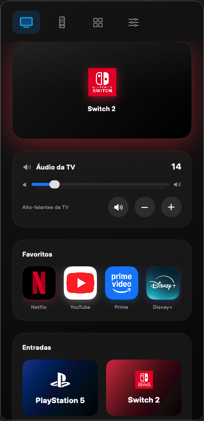
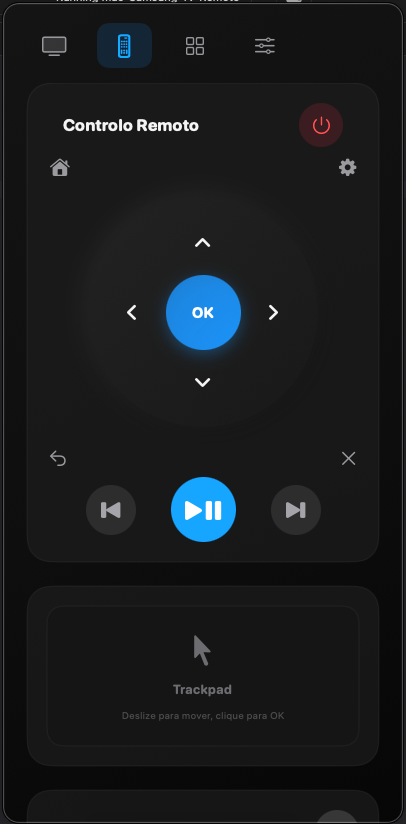
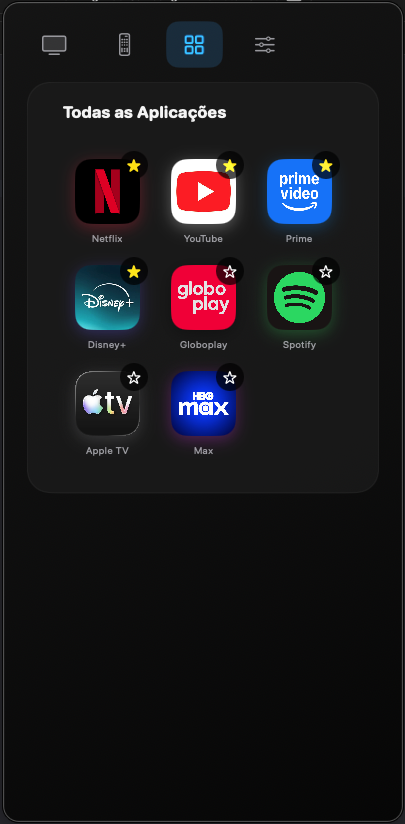
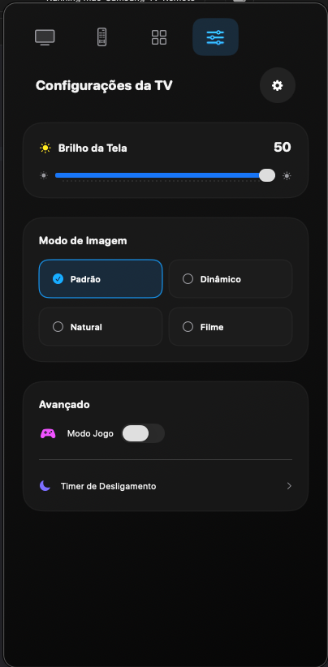

# Mac-NavBar-Samsung-Tv-Remote

A native macOS menu bar remote for Samsung Smart TVs. Launch apps, switch HDMI inputs, control volume, adjust picture settings, and navigate with a trackpad — all just a click away in your Mac's menu bar. Only tested with one model (50" QLED)

This is a community project, independent of Samsung.

## Preview

| TV Home | Trackpad & Media Controls | TV Apps | Settings & Picture Mode |
| :---: | :---: | :---: | :---: |
|  |  |  |  |

## Requirements

- A Mac running macOS 14.0 or later.
- Xcode Command Line Tools with Swift 5.9 or later.
- A Samsung Smart TV (Tizen OS) on the same Wi-Fi or Ethernet network as your Mac.
- A Python 3 virtual environment with the required `samsungtv` CLI tool installed.

## Find your TV and Connect

To use this app, you need to find your TV's local IP address and generate an authentication token.

1. **Find the IP address:** Go to your TV's Network Settings, or check your router's list of connected devices. It looks like `192.168.0.5`.
2. **Get the Auth Token:** You will need to pair with your TV once to generate the `authToken`.
3. **Configure the App:** Open `ContentView.swift` and update the local configuration variables before compiling:
   ```swift
   let tvIP = "YOUR_TV_IP_HERE"
   let authToken = "YOUR_TOKEN_HERE"

   Python Backend: Update the task.executableURL in the source code to point to your local Python virtual environment where the samsungtv CLI is located.

Build and run
Open the project in Xcode, or build it via the command line, and run it on your Mac. The app will live entirely in your macOS menu bar.

Compatibility and limits
App Launcher: Launching specific apps requires knowing their Tizen App IDs (e.g., Netflix is 11101200001). The most common ones are pre-configured.

Settings Control: Changing picture modes and brightness relies on sending specific remote key macros (KEY_MENU, KEY_UP, KEY_ENTER).

Keyboard Input: The app includes a text field to send keyboard strokes directly to the TV's search bars.

Power On/Off: Turning the TV off is supported via KEY_POWER. Turning it back on may require Wake-on-LAN (WoL) to be configured depending on your TV model and network setup.

Privacy and local storage
The app has no analytics, accounts, or cloud services. TV control stays on your local network. Icons are bundled with the app.

No pairing credentials, IP addresses, or network details are tracked or shared. Make sure not to commit your personal tvIP or authToken to public repositories.

Contributing
Bug reports and pull requests are welcome. Use English for code, interface text, documentation, and issues.

When you report a problem, include:

macOS version

TV model and firmware version

Steps to reproduce

A redacted error message

Keep IP addresses, MAC addresses, and pairing tokens out of public issues and pull requests.

License
MIT. See LICENSE.

Third-party notices
Samsung TV Python CLI
This project acts as a native macOS wrapper around a Python-based Samsung TV control library. Commands are dispatched asynchronously via Process() to the underlying Python CLI tool.

Icons and brand assets
The PlayStation, Nintendo, and other app symbol assets are third-party branding. Their respective owners retain rights to their artwork and trademarks. The project's MIT license does not relicense those assets or imply endorsement by Samsung, Sony, Nintendo, Netflix, or other app vendors.


---

